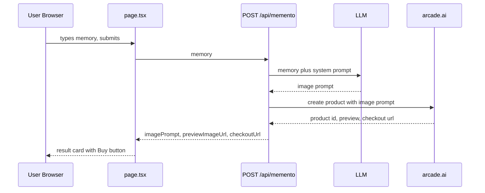

# Memento x Arcade AI (arcade.ai): Execution Plan

## Scope
A single-page Next.js app (App Router + Tailwind). The user enters a memory. The server turns it into an image prompt with an LLM, then asks arcade.ai to create a physical product (for example a decorative pillow) and returns a checkout link.

Out of scope: FastAPI, Pinecone, Firebase, RAG, api.arcade.dev.

## Flow


## File layout
```
src/
  app/
    page.tsx              # client UI: textarea, submit, loading, result, error
    layout.tsx
    globals.css
    api/memento/route.ts  # POST { memory } -> { imagePrompt, checkoutUrl, previewImageUrl? }
  lib/
    env.ts                # server-only env reading and checks
    llm.ts                # generateImagePrompt(memory)
    arcade.ts             # createProduct(imagePrompt), with a mock mode
.env.example
```

## Environment variables (server only, never NEXT_PUBLIC_)
| Var | Purpose |
|---|---|
| ARCADE_API_KEY | arcade.ai secret key |
| ARCADE_API_BASE_URL | arcade.ai base URL (to be confirmed) |
| LLM_API_KEY | LLM provider key |
| LLM_MODEL | model id |
| ARCADE_MOCK | `true` returns a fake checkout URL so the UI can be built before the endpoints are wired |

## API contract: POST /api/memento
Request: `{ "memory": string }`, 10 to 1000 characters.
Success 200: `{ "imagePrompt": string, "checkoutUrl": string, "previewImageUrl"?: string, "productId"?: string }`
Errors: 400 bad input, 502 upstream LLM or arcade failure, 504 timeout. The client sees `{ "error": string }` only, never raw upstream bodies or keys.

## LLM system prompt (draft)
You turn a personal memory into a single image-generation prompt for printed product artwork (a decorative pillow). Output only the prompt, under 80 words. Use a warm, nostalgic illustrative style, with one clear focal subject, a balanced composition that suits a square print, and no text, letters or logos. Do not add people or events that aren't in the memory.

## Open items blocking the real integration
1. arcade.ai endpoints: base URL, auth header format, product-create path and body, response shape, and whether creation is sync or returns a job id to poll.
2. The product type or SKU id for a pillow, and any required size or variant fields.
3. The LLM provider and model.
4. A rotated Arcade key, because the old one was pasted in chat.

## CONFIRMED arcade.ai contract (supersedes the placeholder spec below)
- `POST ${ARCADE_API_BASE_URL}/patterns/create`, with `ARCADE_API_BASE_URL=https://platform.arcade.ai/v1`.
- Headers: `Authorization: Bearer ${ARCADE_API_KEY}`, `Content-Type: application/json`, `User-Agent: memento/1.0`.
- Body: `{ "requestId": crypto.randomUUID(), "prompt": imagePrompt }`. Generate a new requestId on every call so retries are safe.
- The response shape is NOT confirmed, so read it defensively:
  - id: `patternId ?? id ?? pattern?.id`
  - image: `imageUrl ?? image_url ?? previewImageUrl ?? pattern?.imageUrl ?? images?.[0]?.url`
- checkoutUrl: this endpoint makes a pattern, not an order, so return `MOCK_CHECKOUT_URL` plus `checkoutIsMock: true` until the next endpoint in the workflow is known.
- Log the raw response keys on the server the first time, so the real field names can be confirmed and the guesses removed.
- If the response has an id but no image, it is probably async generation. Return `previewImageUrl: undefined` and flag it, then add polling in step 12.

### src/lib/arcade.ts (reference implementation)
```ts
import "server-only";

export type ArcadeResult = {
  productId?: string;
  previewImageUrl?: string;
  checkoutUrl: string;
  checkoutIsMock: boolean;
  status?: string;
};

export class ArcadeError extends Error {
  constructor(message: string, public status?: number, public timeout = false) {
    super(message);
    this.name = "ArcadeError";
  }
}

const MOCK_CHECKOUT_URL = "https://platform.arcade.ai/checkout/mock";
const BASE = (process.env.ARCADE_API_BASE_URL ?? "https://platform.arcade.ai/v1").replace(/\/+$/, "");
const TIMEOUT_MS = Number(process.env.ARCADE_TIMEOUT_MS ?? 30000);
const MOCK = (process.env.ARCADE_MOCK ?? "false").toLowerCase(); // "true" | "fallback" | "false"

function mockResult(): ArcadeResult {
  return {
    productId: `mock_${crypto.randomUUID().slice(0, 8)}`,
    previewImageUrl: "https://placehold.co/800x800/png?text=Memento+Pillow",
    checkoutUrl: MOCK_CHECKOUT_URL,
    checkoutIsMock: true,
    status: "mock",
  };
}

async function callArcade(imagePrompt: string): Promise<ArcadeResult> {
  const apiKey = process.env.ARCADE_API_KEY;
  if (!apiKey) throw new ArcadeError("ARCADE_API_KEY is not set");

  const controller = new AbortController();
  const timer = setTimeout(() => controller.abort(), TIMEOUT_MS);

  let res: Response;
  try {
    res = await fetch(`${BASE}/patterns/create`, {
      method: "POST",
      headers: {
        Authorization: `Bearer ${apiKey}`,
        "Content-Type": "application/json",
        "User-Agent": "memento/1.0",
      },
      body: JSON.stringify({ requestId: crypto.randomUUID(), prompt: imagePrompt }),
      signal: controller.signal,
      cache: "no-store",
    });
  } catch (err) {
    if ((err as Error).name === "AbortError") {
      throw new ArcadeError(`Arcade timed out after ${TIMEOUT_MS}ms`, undefined, true);
    }
    throw new ArcadeError(`Arcade network error: ${(err as Error).message}`);
  } finally {
    clearTimeout(timer);
  }

  const text = await res.text();
  if (!res.ok) {
    throw new ArcadeError(`Arcade ${res.status} ${res.statusText}: ${text.slice(0, 300)}`, res.status);
  }

  let data: any;
  try {
    data = JSON.parse(text);
  } catch {
    throw new ArcadeError(`Arcade returned non-JSON: ${text.slice(0, 300)}`, res.status);
  }

  // Unconfirmed schema: log the keys so the real field names can be pinned down.
  console.info("[arcade] patterns/create response keys:", Object.keys(data ?? {}));

  const d = data?.data ?? data; // tolerate a { data: {...} } envelope
  const productId: string | undefined = d?.patternId ?? d?.id ?? d?.pattern?.id;
  const previewImageUrl: string | undefined =
    d?.imageUrl ?? d?.image_url ?? d?.previewImageUrl ?? d?.pattern?.imageUrl ?? d?.images?.[0]?.url;

  if (!productId && !previewImageUrl) {
    throw new ArcadeError(`Arcade response missing id and image: ${text.slice(0, 300)}`, res.status);
  }

  return {
    productId,
    previewImageUrl,
    checkoutUrl: d?.checkoutUrl ?? d?.checkout_url ?? MOCK_CHECKOUT_URL,
    checkoutIsMock: !(d?.checkoutUrl ?? d?.checkout_url),
    status: d?.status,
  };
}

export async function createProduct(imagePrompt: string): Promise<ArcadeResult> {
  if (MOCK === "true") return mockResult();
  if (MOCK === "fallback") {
    try {
      return await callArcade(imagePrompt);
    } catch (err) {
      console.warn("[arcade] real call failed, using mock fallback:", (err as Error).message);
      return mockResult();
    }
  }
  return callArcade(imagePrompt);
}
```

### route.ts error mapping
```ts
// inside POST, around createProduct()
catch (err) {
  if (err instanceof ArcadeError) {
    console.error("[memento] arcade:", err.message);
    return NextResponse.json(
      { error: err.timeout ? "Product service timed out." : "Product service failed." },
      { status: err.timeout ? 504 : 502 }
    );
  }
  // LlmError -> 502, bad input -> 400, other -> 500
}
```

### Smoke test (run once .env.local has the rotated key)
```sh
curl -sS -X POST https://platform.arcade.ai/v1/patterns/create \
  -H "Authorization: Bearer $ARCADE_API_KEY" \
  -H "Content-Type: application/json" \
  -H "User-Agent: memento/1.0" \
  -d "{\"requestId\":\"$(uuidgen)\",\"prompt\":\"A warm watercolor of a red bicycle under a cherry tree, no text\"}"
```
Then run the app with `ARCADE_MOCK=false` and POST to `/api/memento` with `{"memory":"My grandfather taught me to ride a red bicycle under the cherry tree."}`.

## arcade.ts spec (placeholder REST contract, confirm once real docs arrive)
- `POST ${ARCADE_API_BASE_URL}/v1/products`. Strip any trailing slash from the base URL.
- Headers: `Authorization: Bearer ${ARCADE_API_KEY}` and `Content-Type: application/json`.
- Body: `{ "product_type": "decorative_pillow", "design_prompt": imagePrompt }`.
- Expected response: `{ checkout_url, preview_image_url, product_id }`, mapped to `{ checkoutUrl, previewImageUrl, productId }`.
- Abort the request after `ARCADE_TIMEOUT_MS`, default 30000, using `AbortController`.
- Errors:
  - A non-OK response throws `ArcadeError` with the status and the first 300 characters of the body. These are logged on the server only, never sent to the client.
  - A response with no `checkout_url` also throws `ArcadeError`.
  - A timeout throws `ArcadeError` with `timeout: true`.
- Mock behavior:
  - `ARCADE_MOCK=true` returns the mock result straight away and makes no network call.
  - `ARCADE_MOCK=fallback` tries the real call and returns the mock result on any failure, with a warning in the server log. Use this for live demos only.
  - With mock unset or `false`, failures are thrown.
- Route mapping:
  - `ArcadeError` with `timeout` gives a 504.
  - Any other `ArcadeError` gives a 502.
  - `LlmError` gives a 502.
  - Bad input gives a 400.
  - Anything else gives a 500.
  - The client only ever receives `{ error: string }`.

## Build order
1. Scaffold the app, env files and the `lib/env.ts` checks.
2. Write `arcade.ts` with mock mode first, so the UI and route work end to end.
3. Add `llm.ts` and the route.
4. Build the page UI.
5. Replace the mock with the real arcade.ai calls once the endpoints are provided, adding polling if creation is async.
6. Write the README and deploy to Vercel.
